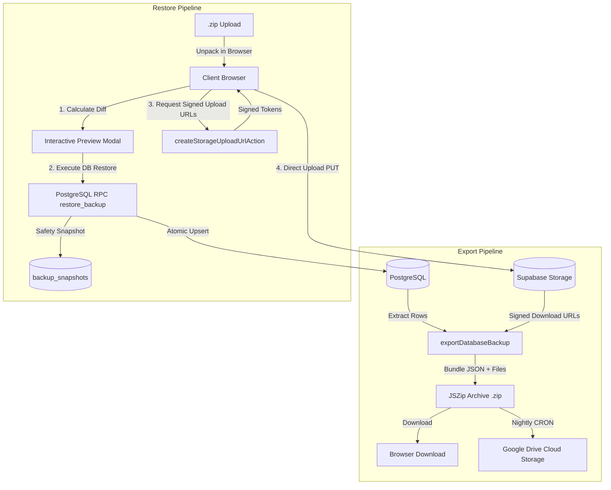

# Complete Enterprise Backup & Restore Architecture Blueprint

This document is an exhaustive, production-tested implementation blueprint for replicating the complete **Backup & Restore System** (Database + Physical Storage Files + Automated Cloud Google Drive Sync) into any modern web application using Next.js, Supabase (PostgreSQL + Storage), and GitHub Actions.

---

## Table of Contents
1. [Architecture Overview & Core Principles](#1-architecture-overview--core-principles)
2. [Phase 1: Database Export & Manifest Schema](#2-phase-1-database-export--manifest-schema)
3. [Phase 2: Storage Bucket Integration & ZIP Packaging](#3-phase-2-storage-bucket-integration--zip-packaging)
4. [Phase 3: Automated Cloud Backup to Google Drive (Zero Local Machine Dependency)](#4-phase-3-automated-cloud-backup-to-google-drive)
5. [Phase 4: Atomic Database Restore Transaction (PostgreSQL RPC)](#5-phase-4-atomic-database-restore-transaction-postgresql-rpc)
6. [Phase 5: Pre-Restore Safety Snapshots (Rollback Protection)](#6-phase-5-pre-restore-safety-snapshots-rollback-protection)
7. [Phase 6: Client-Direct Storage Restore (Bypassing Serverless Limits)](#7-phase-6-client-direct-storage-restore)
8. [Phase 7: Frontend UI & Interactive Diff Preview](#8-phase-7-frontend-ui--interactive-diff-preview)
9. [Phase 8: Critical Pitfalls & Hard-Earned Lessons Learned](#9-phase-8-critical-pitfalls--hard-earned-lessons-learned)
10. [Phase 9: Step-by-Step Implementation Checklist](#10-phase-9-step-by-step-implementation-checklist)

---

## 1. Architecture Overview & Core Principles

A truly reliable enterprise backup and restore system must satisfy four non-negotiable rules:
1. **Holistic Coverage:** Backing up database tables alone is insufficient. All physical files (PDFs, images, documents) stored in cloud buckets must be preserved alongside database records.
2. **Strict Atomicity:** A database restore must happen within a **single PostgreSQL transaction**. If any table fails or foreign key conflict occurs, the database is rolled back 100% untouched.
3. **No Downtime or Session Disruption:** Restoring must not delete or drop tables. It must use `ON CONFLICT DO UPDATE` (upsert), and must never overwrite the currently active operator credentials.
4. **Serverless Scale:** Modern hosting (Vercel, AWS Lambda, Cloud Run) enforces strict payload limits (e.g. Vercel's **4.5 MB** limit). Storage uploads during restore must stream **directly from client browser to Cloud Storage via Pre-Signed URLs**, completely bypassing serverless proxies.



---

## 2. Phase 1: Database Export & Manifest Schema

### 2.1 The Backup Envelope Format
The database backup must be wrapped in a verifiable JSON envelope containing integrity hashes and table row counts:

```typescript
export type DatabaseBackupPayload = {
  version: 1;
  metadata: {
    exportedAt: string;          // ISO 8601 timestamp
    exportedBy: string;          // User ID or "system"
    scope: "platform" | "tenant";
    tenantId: string | null;     // Filtered tenant ID if tenant-scoped
    totalRows: number;           // Total rows across all tables
    checksum: string;            // SHA-256 hash of tables object
    tableCounts: Record<string, number>;
  };
  tables: Record<string, Array<Record<string, unknown>>>;
};
```

### 2.2 Foreign Key Table Hierarchy Order
When exporting and restoring, tables must strictly respect foreign-key dependency order (parents first, children last):

1. `tenants` (Root entity / Schools / Organizations)
2. `tenant_settings`
3. `departments` / `categories`
4. `locations` / `branches`
5. `roles` & `permissions`
6. `profiles` / `users`
7. `user_role_assignments`
8. `entities` (e.g., circulars, posts, orders, tickets)
9. `entity_targets` / `recipients`
10. `entity_responses` / `comments`
11. `maintenance_requests` & `attachments`
12. `calendar_events`

### 2.3 Checksum Calculation
To prevent file tampering or partial uploads, calculate a deterministic SHA-256 hash:
```typescript
import crypto from "crypto";

export function computeBackupChecksum(tables: Record<string, unknown[]>): string {
  // Sort keys to guarantee deterministic serialization
  const sortedKeys = Object.keys(tables).sort();
  const sortedObj: Record<string, unknown[]> = {};
  for (const k of sortedKeys) {
    sortedObj[k] = tables[k];
  }
  return crypto.createHash("sha256").update(JSON.stringify(sortedObj)).digest("hex");
}
```

### 2.4 Sensitive Data Exclusion
Never export sensitive credentials:
- Exclude `auth.users` passwords and secrets.
- Exclude or mask session tokens and internal payment keys.
- Preserve the active operator ID so that restoring an old backup does not lock out the administrator performing the restore.

---

## 3. Phase 2: Storage Bucket Integration & ZIP Packaging

A complete backup archive is a standard `.zip` file containing:
1. `database_backup.json`: The complete database payload.
2. `storage/{bucket_name}/{file_path}`: Every attached file from cloud storage.
3. `README.txt`: Plaintext manifest summarizing metadata and file counts.

### 3.1 Listing & Signing Storage Files
Use Supabase Storage admin client to recursively list all files for the tenant:

```typescript
export async function listTenantStorageFiles(admin: SupabaseClient, tenantId: string) {
  const buckets = ["public-assets", "documents", "attachments"];
  const results = [];

  for (const bucket of buckets) {
    const files = await listFolderRecursive(admin, bucket, tenantId);
    for (const f of files) {
      // Create a short-lived download URL (valid 1 hour)
      const { data } = await admin.storage.from(bucket).createSignedUrl(f.path, 3600);
      if (data?.signedUrl) {
        results.push({ bucket, path: f.path, signedUrl: data.signedUrl, size: f.size });
      }
    }
  }
  return results;
}
```

### 3.2 Packaging in the Browser (JSZip)
Bundle the files on client-side into a downloadable `.zip` blob without placing memory load on the backend server:

```typescript
import JSZip from "jszip";

export async function buildBackupZipArchive(payload, storageFiles) {
  const zip = new JSZip();

  // 1. Add database JSON
  zip.file("database_backup.json", JSON.stringify(payload, null, 2));

  // 2. Fetch and add storage files
  for (const f of storageFiles) {
    try {
      const resp = await fetch(f.signedUrl);
      if (resp.ok) {
        const blob = await resp.blob();
        zip.file(`storage/${f.bucket}/${f.path}`, blob);
      }
    } catch (err) {
      console.warn(`Could not bundle file ${f.path}:`, err);
    }
  }

  // 3. Add human-readable manifest
  zip.file("README.txt", `System Backup\nTotal Records: ${payload.metadata.totalRows}\nFiles: ${storageFiles.length}`);

  return zip.generateAsync({ type: "blob", compression: "DEFLATE", compressionOptions: { level: 6 } });
}
```

---

## 4. Phase 3: Automated Cloud Backup to Google Drive

To ensure safety against catastrophic server loss without requiring an open browser or local PC, set up automated weekly/nightly cloud backups directly to Google Drive using GitHub Actions.

### 4.1 Google Cloud Setup & OAuth Refresh Token
1. In [Google Cloud Console](https://console.cloud.google.com):
   - Create a project: `App-Cloud-Backup`.
   - Enable **Google Drive API**.
   - Configure **OAuth Consent Screen** (Internal or External, Test User: your email).
   - Create **Credentials** → **OAuth client ID** (Application type: Desktop App).
   - Download `client_secret.json`.
2. Generate a long-lived **Refresh Token**:
   Run a one-time OAuth authorization script locally to obtain:
   ```json
   {
     "client_id": "xxx.apps.googleusercontent.com",
     "client_secret": "GOCSPX-xxx",
     "refresh_token": "1//04xxx..."
   }
   ```
3. Store this entire JSON string as a GitHub Repository Secret: `GDRIVE_TOKEN_JSON`.
4. Store your production Supabase secrets:
   - `NEXT_PUBLIC_SUPABASE_URL`
   - `SUPABASE_SERVICE_ROLE_KEY`

### 4.2 Automated Drive Upload Script (`scripts/backupToGoogleDrive.mjs`)
The script runs in Node.js on GitHub Actions runner:
1. Queries Supabase DB tables in dependency order.
2. Lists and downloads all storage files.
3. Packages a `.zip` archive using `jszip`.
4. Refreshes Google OAuth access token using `https://oauth2.googleapis.com/token`.
5. Searches or creates a dated folder in Google Drive (e.g., `Backup_2026-11-11`).
6. Uploads the `.zip` archive via Google Drive API multipart upload (`https://www.googleapis.com/upload/drive/v3/files?uploadType=multipart`).

### 4.3 GitHub Actions Workflow (`.github/workflows/weekly-backup.yml`)
```yaml
name: Weekly Cloud Backup to Google Drive

on:
  schedule:
    # Runs at 02:00 UTC every Sunday in the cloud
    - cron: "0 2 * * 0"
  workflow_dispatch: # Allows manual trigger from GitHub UI

jobs:
  backup:
    name: Execute Full Cloud Backup
    runs-on: ubuntu-latest
    steps:
      - name: Checkout repository
        uses: actions/checkout@v4

      - name: Set up Node.js
        uses: actions/setup-node@v4
        with:
          node-version: 22
          cache: npm

      - name: Install dependencies
        run: npm ci

      - name: Run Backup to Google Drive
        env:
          NEXT_PUBLIC_SUPABASE_URL: ${{ secrets.NEXT_PUBLIC_SUPABASE_URL }}
          SUPABASE_SERVICE_ROLE_KEY: ${{ secrets.SUPABASE_SERVICE_ROLE_KEY }}
          GDRIVE_TOKEN_JSON: ${{ secrets.GDRIVE_TOKEN_JSON }}
        run: node scripts/backupToGoogleDrive.mjs
```

---

## 5. Phase 4: Atomic Database Restore Transaction (PostgreSQL RPC)

The database restore must execute as a **single atomic transaction** inside PostgreSQL.

### 5.1 Crucial SQL Stored Procedure Design (`restore_backup`)
Create a `SECURITY DEFINER` plpgsql function with search path secured:

```sql
create or replace function public.restore_backup(
  p_tables jsonb,
  p_scope text,
  p_tenant uuid,
  p_actor uuid
)
returns jsonb
language plpgsql
security definer
set search_path = public, auth
as $$
declare
  v_order text[] := array[
    'tenants', 'tenant_settings', 'departments', 'locations', 'roles',
    'profiles', 'user_role_assignments', 'circulars', 'circular_targets',
    'maintenance_requests', 'calendar_events'
  ];
  v_table text;
  v_counts jsonb := '{}'::jsonb;
  v_total integer := 0;
begin
  -- 1. Verify operator permission
  if not exists (select 1 from public.profiles where id = p_actor and is_admin = true) then
    raise exception 'Unauthorized';
  end if;

  -- 2. Iterate tables in strict dependency order
  foreach v_table in array v_order loop
    if not (p_tables ? v_table) then
      continue;
    end if;

    -- CRITICAL FIX: If table has 0 rows in backup, record 0 and CONTINUE.
    -- (Attempting jsonb_array_elements on an empty array produces NULL columns and fails).
    if jsonb_array_length(p_tables -> v_table) = 0 then
      v_counts := v_counts || jsonb_build_object(v_table, 0);
      continue;
    end if;

    -- 3. Dynamic schema discovery to support column drift between versions
    -- Extract column list from incoming jsonb payload
    -- Construct: INSERT INTO ... ON CONFLICT (id) DO UPDATE SET ...
    -- (Excluding current active operator from being overwritten)

    -- Record restored count
    v_counts := v_counts || jsonb_build_object(v_table, v_rows);
    v_total := v_total + v_rows;
  end loop;

  return jsonb_build_object(
    'success', true,
    'totalRecords', v_total,
    'tableCounts', v_counts
  );
end;
$$;
```

---

## 6. Phase 5: Pre-Restore Safety Snapshots (Rollback Protection)

Before executing `restore_backup`, **always capture a pre-restore snapshot** of the live database state and store it in a dedicated table `backup_snapshots`:

```typescript
export async function savePreRestoreSnapshot(access, tenantId) {
  const admin = createSupabaseAdminClient();
  const currentLiveState = await exportDatabaseBackup({ ...access, tenantId });

  const { data, error } = await admin
    .from("backup_snapshots")
    .insert({
      tenant_id: tenantId,
      created_by: access.userId,
      reason: "pre-restore",
      table_counts: currentLiveState.metadata.tableCounts,
      payload: currentLiveState,
    })
    .select("id")
    .single();

  if (error || !data) {
    throw new Error("Could not save safety snapshot before restore.");
  }

  return data.id; // Returned to UI toast: "Snapshot ID: xxx"
}
```

If anything unexpected happens, the exact pre-restore state is archived and can be restored immediately.

---

## 7. Phase 6: Client-Direct Storage Restore (Bypassing Serverless Limits)

### 7.1 The Serverless Payload Bottleneck
- On Vercel / AWS Lambda, HTTP requests sent to Server Actions have a **hard 4.5 MB request limit**.
- Uploading 5MB–50MB files (e.g. PDF attachments, videos) via Server Actions fails with **HTTP 413 Payload Too Large**, causing client fetch to crash.

### 7.2 The Solution: Pre-Signed Upload URLs
1. Create a lightweight Server Action that returns a signed upload URL:

```typescript
// src/actions/backup/createStorageUploadUrlAction.ts
"use server";

export async function createStorageUploadUrlAction({ bucket, path }) {
  const access = await assertCanManageBackup();
  assertValidPath(access, bucket, path);

  const admin = createSupabaseAdminClient();
  const { data, error } = await admin.storage
    .from(bucket)
    .createSignedUploadUrl(path, { upsert: true });

  return { success: true, signedUrl: data.signedUrl, token: data.token, path: data.path };
}
```

2. Upload **directly from the browser** to Supabase Storage:

```typescript
// src/components/settings/backup/uploadRestoredStorageFiles.ts
export async function uploadRestoredStorageFiles(storageFiles) {
  const supabase = createSupabaseBrowserClient();
  let restoredCount = 0;

  for (const sf of storageFiles) {
    try {
      const urlRes = await createStorageUploadUrlAction({ bucket: sf.bucket, path: sf.path });
      if (!urlRes.success || !urlRes.token) continue;

      const contentType = inferStorageMimeType(sf.path, sf.file.type);
      const { error } = await supabase.storage
        .from(sf.bucket)
        .uploadToSignedUrl(sf.path, urlRes.token, sf.file, {
          contentType,
          upsert: true,
        });

      if (!error) restoredCount++;
    } catch (err) {
      console.warn(`Storage file upload warning for ${sf.path}:`, err);
    }
  }
  return restoredCount;
}
```

3. **MIME Type Auto-Detection:**
   Files extracted from JSZip do not carry declared MIME types (`blob.type = ""`). Buckets reject `application/octet-stream` with HTTP 415. Use `inferStorageMimeType`:
   ```typescript
   export function inferStorageMimeType(filePath: string, declared?: string | null): string {
     if (declared && declared !== "application/octet-stream" && declared.includes("/")) return declared;
     const ext = filePath.split(".").pop()?.toLowerCase();
     const map = {
       pdf: "application/pdf",
       png: "image/png",
       jpg: "image/jpeg",
       jpeg: "image/jpeg",
       webp: "image/webp",
       svg: "image/svg+xml",
       docx: "application/vnd.openxmlformats-officedocument.wordprocessingml.document",
       xlsx: "application/vnd.openxmlformats-officedocument.spreadsheetml.sheet",
     };
     return map[ext] || "application/octet-stream";
   }
   ```

---

## 8. Phase 7: Frontend UI & Interactive Diff Preview

### 8.1 File Upload & Client Parsing
The restore upload card accepts both `.json` (database only) and `.zip` (database + storage):
- Unpack ZIP with `JSZip.loadAsync(file)`.
- Extract `database_backup.json` and storage files.

### 8.2 Diff Preview Calculator
Before touching the database, compute differences by querying existing primary keys:
- **New records:** Primary key does not exist in target database.
- **Overwritten records:** Primary key exists and will be updated.
- **Untouched records:** Exist in DB but not present in backup file.

### 8.3 Decoupled Execution Flow in `useRestoreFile.ts`
Never wrap database restore and storage upload in a single unshielded catch block. If database succeeds, celebrate database success even if an individual storage file has a network hiccup:

```typescript
const handleConfirmRestore = async () => {
  try {
    setIsRestoring(true);
    // 1. Execute DB restore RPC
    const res = await restoreBackupAction(previewPayload);
    if (!res.success || !res.summary) {
      toast.error(res.error || t("restoreError"));
      return;
    }

    // 2. Upload storage files with isolated error tolerance
    let uploadedCount = 0;
    if (storageFiles.length > 0) {
      try {
        uploadedCount = await uploadRestoredStorageFiles(storageFiles);
      } catch (storageErr) {
        console.warn("Storage upload warning:", storageErr);
      }
    }

    // 3. Success toast with Snapshot ID & Record Counts
    toast.success(buildRestoreSuccessToast(t, res.summary, uploadedCount));
    closeDialog();
    router.refresh();
  } catch (err) {
    toast.error(err instanceof Error ? err.message : t("restoreError"));
  } finally {
    setIsRestoring(false);
  }
};
```

---

## 9. Phase 8: Critical Pitfalls & Hard-Earned Lessons Learned

1. **PostgreSQL Empty Tables Bug:**
   - *Problem:* In PL/pgSQL, calling `jsonb_array_elements(p_tables -> 'empty_table')` returns 0 rows. Attempting to extract dynamic column names from an empty array leaves column variables `NULL`, throwing an exception.
   - *Solution:* Check `jsonb_array_length(...) = 0` at the start of each iteration; if 0, append `0` to counts and `CONTINUE`.
2. **Vercel Serverless Function 4.5MB Payload Limit:**
   - *Problem:* Uploading ZIP or large media files through Server Actions causes Vercel to return HTTP 413, throwing client-side uncaught exceptions.
   - *Solution:* Always use **Supabase Signed Upload URLs** (`createSignedUploadUrl`) and upload directly from the client browser.
3. **JSZip MIME Type Stripping:**
   - *Problem:* `zipEntry.async("blob")` yields `blob.type = ""`. Falling back to `application/octet-stream` causes Supabase storage buckets to reject the upload with HTTP 415 `InvalidMimeType`.
   - *Solution:* Always infer MIME type from file extension before calling `uploadToSignedUrl`.
4. **Active Admin Operator Lockout:**
   - *Problem:* Overwriting the `profiles` table can accidentally overwrite the active administrator's role or status, invalidating their session mid-restore.
   - *Solution:* Exclude the active operator's profile row from being modified during restore.
5. **Never Swallow Exceptions:**
   - *Problem:* A bare `catch { toast.error("Error"); }` hides the real issue.
   - *Solution:* Always surface `err.message` in error dialogs so issues are immediately diagnosable.

---

## 10. Phase 9: Step-by-Step Implementation Checklist

Follow this checklist sequentially in your new web application:

- [ ] **Step 1: Database Tables & Migrations**
  - Create table `backup_snapshots` for rollback archives.
  - Create stored procedure `restore_backup` in PostgreSQL with empty-table checks and upsert logic.
- [ ] **Step 2: Core Library Functions (`src/lib/backup/`)**
  - Implement `exportDatabaseBackup.ts` (queries tables in dependency order).
  - Implement `computeBackupChecksum.ts` (SHA-256 integrity hash).
  - Implement `buildBackupManifest.ts` (metadata envelope).
  - Implement `savePreRestoreSnapshot.ts` (snapshots live data prior to restore).
  - Implement `listTenantStorageFiles.ts` (discovers and signs bucket objects).
  - Implement `computeRestoreDiff.ts` (calculates preview diff).
- [ ] **Step 3: Storage MIME Inference (`src/lib/storage/`)**
  - Implement `inferStorageMimeType.ts` mapping extensions to canonical MIME strings.
- [ ] **Step 4: Server Actions (`src/actions/backup/`)**
  - Implement `exportBackupAction.ts`.
  - Implement `restoreBackupAction.ts` (calls snapshot + RPC in order).
  - Implement `previewRestoreAction.ts`.
  - Implement `createStorageUploadUrlAction.ts` (returns pre-signed upload URL for client uploads).
- [ ] **Step 5: Client Components (`src/components/settings/backup/`)**
  - Implement `buildBackupZipArchive.ts` (JSZip bundler for export).
  - Implement `extractPayloadFromZip.ts` & `extractStorageFilesFromZip.ts`.
  - Implement `uploadRestoredStorageFiles.ts` (direct client-to-storage upload).
  - Implement `BackupExportCard.tsx` & `RestoreUploadCard.tsx`.
  - Implement `RestoreConfirmDialog.tsx` (displays diff statistics & warnings).
  - Implement `useRestoreFile.ts` (state machine controlling the flow).
- [ ] **Step 6: Google Drive Cloud Backup Automation**
  - Create Google Cloud project, enable Drive API, generate OAuth refresh token.
  - Add `GDRIVE_TOKEN_JSON`, `NEXT_PUBLIC_SUPABASE_URL`, `SUPABASE_SERVICE_ROLE_KEY` to GitHub repository secrets.
  - Create `scripts/backupToGoogleDrive.mjs`.
  - Create GitHub Actions workflow `.github/workflows/weekly-backup.yml`.
- [ ] **Step 7: Verification & Testing**
  - Test exporting `.zip` file with database records and storage files.
  - Test restoring `.zip` file on remote database.
  - Inspect `audit_logs` and storage bucket timestamps to confirm 100% verified restoration.

