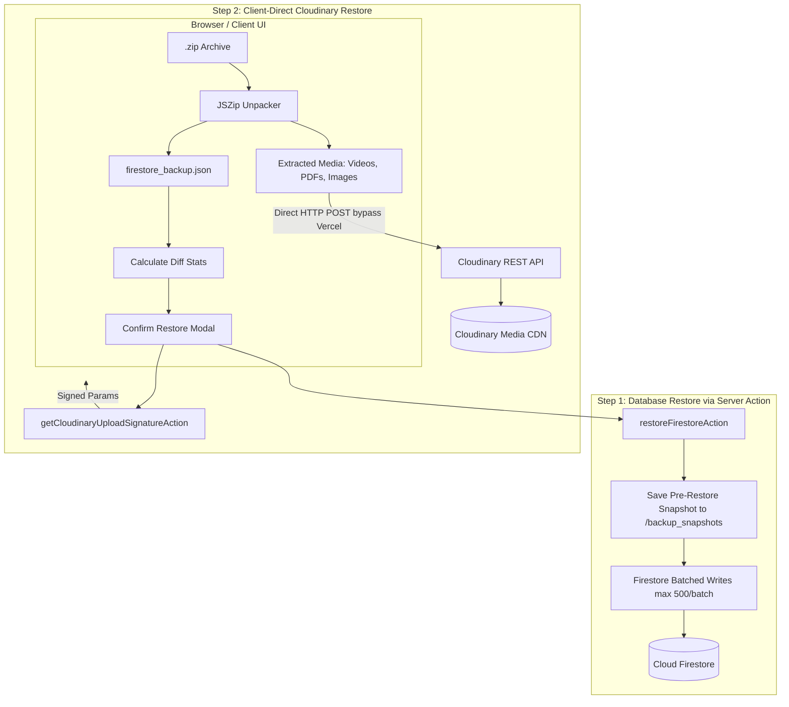

# Enterprise Backup & Restore Architecture: Next.js + Firestore + Cloudinary + Vercel

This implementation guide adapts the proven multi-tenant backup & restore architecture specifically for **Google Cloud Firestore** (NoSQL Document Store), **Cloudinary** (Media & File Storage for images, PDFs, DOCX, and videos), **Vercel** (Serverless hosting), and **Google Drive** (Automated weekly cloud backups).

---

## Table of Contents
1. [Core Architectural Adaptations (Firestore vs PostgreSQL, Cloudinary vs Supabase)](#1-core-architectural-adaptations)
2. [Vercel 4.5 MB Serverless Limit & Cloudinary Direct Signed Uploads](#2-vercel-45-mb-serverless-limit--cloudinary-direct-signed-uploads)
3. [Phase 1: Multi-Tenant Firestore Export & Serialization](#3-phase-1-multi-tenant-firestore-export--serialization)
4. [Phase 2: Cloudinary Asset Export & ZIP Packaging](#4-phase-2-cloudinary-asset-export--zip-packaging)
5. [Phase 3: Automated Cloud Backup via GitHub Actions to Google Drive](#5-phase-3-automated-cloud-backup-via-github-actions-to-google-drive)
6. [Phase 4: Atomic Firestore Restore (Batched Writes & Empty Check)](#6-phase-4-atomic-firestore-restore-batched-writes--empty-check)
7. [Phase 5: Pre-Restore Safety Snapshot in Firestore](#7-phase-5-pre-restore-safety-snapshot-in-firestore)
8. [Phase 6: Client-Direct Cloudinary Restore (Zero Vercel Payload Impact)](#8-phase-6-client-direct-cloudinary-restore-zero-vercel-payload-impact)
9. [Phase 7: Frontend UI, Diff Calculator & Progress Reporting](#9-phase-7-frontend-ui-diff-calculator--progress-reporting)
10. [Phase 8: Critical Pitfalls & Checklist for the New App](#10-phase-8-critical-pitfalls--checklist-for-the-new-app)

---

## 1. Core Architectural Adaptations

| Feature | School App (Supabase Stack) | New Web App (Firestore + Cloudinary Stack) |
| :--- | :--- | :--- |
| **Database** | PostgreSQL (Relational tables, foreign keys) | Firestore (Collections, documents, subcollections) |
| **Transaction Method** | PostgreSQL PL/pgSQL Function (`restore_backup` RPC) | Firestore Batched Writes (500 ops per chunk) with `{ merge: true }` |
| **File Storage** | Supabase Storage (S3-compatible buckets) | Cloudinary (`image`, `raw` for PDFs/DOCX, `video`) |
| **Direct Uploads** | Supabase `createSignedUploadUrl` | Cloudinary Signed Direct Uploads (`api.cloudinary.com/.../upload`) |
| **Hosting Limit** | Vercel 4.5 MB Serverless Payload Limit | **Vercel 4.5 MB Serverless Payload Limit** (Must bypass for media!) |
| **Cloud Backup** | GitHub Actions + Supabase Admin Client | GitHub Actions + Firebase Admin SDK + Cloudinary API |



---

## 2. Vercel 4.5 MB Serverless Limit & Cloudinary Direct Signed Uploads

### The Bottleneck
On Vercel (both Hobby and Pro plans), requests sent to Serverless Functions and Next.js Server Actions have a **strict 4.5 MB request body limit**.
- If a user attempts to upload a **10 MB PDF**, a **25 MB video**, or a **50 MB ZIP** through a Next.js Server Action (`"use server"`), Vercel's edge proxy immediately rejects the request with **HTTP 413 `FUNCTION_PAYLOAD_TOO_LARGE`**.
- This throws an uncatchable network error on the frontend, completely breaking restore.

### The Solution: Cloudinary Direct Signed Uploads
**Never send file binaries through Next.js Server Actions on Vercel.**
Instead:
1. The client asks a Next.js Server Action for an upload signature (passes only lightweight metadata: `public_id`, `folder`, `timestamp`).
2. The Server Action uses the Cloudinary API secret to sign the parameters (`cloudinary.utils.api_sign_request`).
3. The browser uploads the binary **directly** to `https://api.cloudinary.com/v1_1/<cloud_name>/<resource_type>/upload`.
4. Videos, high-resolution photos, and large DOCX/PDF files stream straight from the browser into Cloudinary without touching Vercel servers.

---

## 3. Phase 1: Multi-Tenant Firestore Export & Serialization

### 3.1 Firestore Data Types Serialization
Firestore contains non-standard JSON types: `Timestamp`, `DocumentReference`, `GeoPoint`, and `Bytes`. You must serialize these consistently:

```typescript
// src/lib/backup/serializeFirestoreDoc.ts
import { Timestamp, DocumentReference, GeoPoint } from "firebase-admin/firestore";

export function serializeFirestoreValue(value: unknown): unknown {
  if (value === null || value === undefined) return value;
  if (value instanceof Timestamp) {
    return { _type: "timestamp", value: value.toDate().toISOString() };
  }
  if (value instanceof DocumentReference) {
    return { _type: "ref", path: value.path };
  }
  if (value instanceof GeoPoint) {
    return { _type: "geopoint", latitude: value.latitude, longitude: value.longitude };
  }
  if (Array.isArray(value)) {
    return value.map(serializeFirestoreValue);
  }
  if (typeof value === "object") {
    const res: Record<string, unknown> = {};
    for (const [k, v] of Object.entries(value)) {
      res[k] = serializeFirestoreValue(v);
    }
    return res;
  }
  return value;
}
```

### 3.2 Tenant-Scoped Export
Export each collection filtered by `tenantId` (e.g. `organizationId` or `schoolId`):

```typescript
// src/lib/backup/exportFirestoreBackup.ts
import { getFirestore } from "firebase-admin/firestore";

const COLLECTIONS = [
  "organizations",
  "organization_settings",
  "departments",
  "users",
  "roles",
  "posts",
  "comments",
  "documents",
  "media_items",
];

export async function exportFirestoreBackup(tenantId: string) {
  const db = getFirestore();
  const tables: Record<string, unknown[]> = {};
  let totalRows = 0;

  for (const collName of COLLECTIONS) {
    let query = db.collection(collName) as FirebaseFirestore.Query;
    // Root tenant collection matches by doc ID; child collections match by tenantId
    if (collName === "organizations") {
      query = query.where("__name__", "==", tenantId);
    } else {
      query = query.where("tenantId", "==", tenantId);
    }

    const snapshot = await query.get();
    const rows: unknown[] = [];
    for (const doc of snapshot.docs) {
      rows.push({ _id: doc.id, ...serializeFirestoreValue(doc.data()) });
      totalRows++;
    }
    tables[collName] = rows;
  }

  const checksum = computeBackupChecksum(tables);

  return {
    version: 1,
    metadata: {
      exportedAt: new Date().toISOString(),
      scope: "tenant",
      tenantId,
      totalRows,
      checksum,
      tableCounts: Object.fromEntries(Object.entries(tables).map(([k, v]) => [k, v.length])),
    },
    tables,
  };
}
```

---

## 4. Phase 2: Cloudinary Asset Export & ZIP Packaging

### 4.1 Discovering Tenant Cloudinary Assets
In Cloudinary, tag every asset with `tenant_${tenantId}` or place them in a folder `tenants/${tenantId}/*`.
Use the Cloudinary Search API to fetch asset download URLs:

```typescript
// src/lib/backup/listTenantCloudinaryAssets.ts
import { v2 as cloudinary } from "cloudinary";

export async function listTenantCloudinaryAssets(tenantId: string) {
  // Query by folder or tag
  const results = await cloudinary.search
    .expression(`folder:tenants/${tenantId}/*`)
    .max_results(500)
    .execute();

  return results.resources.map((res: any) => ({
    public_id: res.public_id,
    resource_type: res.resource_type, // "image" | "video" | "raw"
    format: res.format,
    secure_url: res.secure_url,
    bytes: res.bytes,
  }));
}
```

### 4.2 Browser ZIP Packaging (JSZip)
Bundle the Firestore JSON + all Cloudinary media files into a single `.zip` file:
```typescript
import JSZip from "jszip";

export async function buildCloudinaryBackupZip(payload, assets) {
  const zip = new JSZip();

  // 1. Database JSON
  zip.file("firestore_backup.json", JSON.stringify(payload, null, 2));

  // 2. Fetch and package assets
  for (const asset of assets) {
    try {
      const resp = await fetch(asset.secure_url);
      if (resp.ok) {
        const blob = await resp.blob();
        const ext = asset.format ? `.${asset.format}` : "";
        zip.file(`storage/${asset.resource_type}/${asset.public_id}${ext}`, blob);
      }
    } catch (err) {
      console.warn(`Failed to package asset ${asset.public_id}:`, err);
    }
  }

  // 3. Manifest
  zip.file("README.txt", `Backup Manifest\nTenant: ${payload.metadata.tenantId}\nRecords: ${payload.metadata.totalRows}\nAssets: ${assets.length}`);

  return zip.generateAsync({ type: "blob", compression: "DEFLATE", compressionOptions: { level: 6 } });
}
```

---

## 5. Phase 3: Automated Cloud Backup via GitHub Actions to Google Drive

A standalone runner script that runs on GitHub Actions every Sunday at 02:00 UTC with zero machine dependencies.

### 5.1 GitHub Secrets Required
- `FIREBASE_SERVICE_ACCOUNT_KEY`: The JSON string of your Firebase Admin private key.
- `CLOUDINARY_URL`: `cloudinary://<api_key>:<api_secret>@<cloud_name>`.
- `GDRIVE_TOKEN_JSON`: Google Drive OAuth refresh token JSON (`client_id`, `client_secret`, `refresh_token`).

### 5.2 Standalone Backup Script (`scripts/backupToGoogleDrive.mjs`)
1. Initializes Firebase Admin (`cert(JSON.parse(process.env.FIREBASE_SERVICE_ACCOUNT_KEY))`).
2. Configures Cloudinary (`cloudinary.config(...)`).
3. Exports all Firestore collections for each tenant.
4. Downloads all Cloudinary media files and bundles into a dated `.zip`.
5. Refreshes Google Drive token via `https://oauth2.googleapis.com/token`.
6. Uploads the `.zip` archive to Google Drive under a dated folder (`Backup_YYYY-MM-DD`).

### 5.3 GitHub Actions Workflow (`.github/workflows/weekly-backup.yml`)
```yaml
name: Weekly Cloud Backup to Google Drive

on:
  schedule:
    - cron: "0 2 * * 0" # Every Sunday at 02:00 UTC
  workflow_dispatch:

jobs:
  backup:
    name: Execute Full Cloud Backup
    runs-on: ubuntu-latest
    steps:
      - name: Checkout repository
        uses: actions/checkout@v4

      - name: Setup Node.js
        uses: actions/setup-node@v4
        with:
          node-version: 22
          cache: npm

      - name: Install dependencies
        run: npm ci

      - name: Run Backup to Google Drive
        env:
          FIREBASE_SERVICE_ACCOUNT_KEY: ${{ secrets.FIREBASE_SERVICE_ACCOUNT_KEY }}
          CLOUDINARY_URL: ${{ secrets.CLOUDINARY_URL }}
          GDRIVE_TOKEN_JSON: ${{ secrets.GDRIVE_TOKEN_JSON }}
        run: node scripts/backupToGoogleDrive.mjs
```

---

## 6. Phase 4: Atomic Firestore Restore (Batched Writes & Empty Check)

Firestore does not have SQL tables or PostgreSQL RPCs. Restoring requires **Batched Writes** (`writeBatch()`) which commit up to 500 documents per batch atomically.

### 6.1 Deserializing Custom Types
Convert `{ _type: "timestamp", value: "..." }` back to `Timestamp.fromDate(new Date(...))`:

```typescript
// src/lib/backup/deserializeFirestoreDoc.ts
import { Timestamp, GeoPoint } from "firebase-admin/firestore";

export function deserializeFirestoreValue(val: any): any {
  if (val && typeof val === "object") {
    if (val._type === "timestamp") return Timestamp.fromDate(new Date(val.value));
    if (val._type === "geopoint") return new GeoPoint(val.latitude, val.longitude);
    if (Array.isArray(val)) return val.map(deserializeFirestoreValue);
    const res: Record<string, any> = {};
    for (const [k, v] of Object.entries(val)) res[k] = deserializeFirestoreValue(v);
    return res;
  }
  return val;
}
```

### 6.2 Chunked Batched Writes (500 Limit Protection)
Crucial rule learned from the PostgreSQL empty tables bug: **Always guard against empty arrays!**

```typescript
// src/lib/backup/restoreFirestoreBackup.ts
import { getFirestore } from "firebase-admin/firestore";

export async function restoreFirestoreBackup(payload: DatabaseBackupPayload, activeOperatorId: string) {
  const db = getFirestore();
  let totalRestored = 0;
  const tableCounts: Record<string, number> = {};

  for (const [collName, docs] of Object.entries(payload.tables)) {
    // 1. Guard against empty arrays
    if (!docs || docs.length === 0) {
      tableCounts[collName] = 0;
      continue;
    }

    // 2. Chunk documents into batches of 450 (under the 500 limit)
    const CHUNK_SIZE = 450;
    for (let i = 0; i < docs.length; i += CHUNK_SIZE) {
      const chunk = docs.slice(i, i + CHUNK_SIZE);
      const batch = db.batch();

      for (const item of chunk) {
        const { _id, ...rawDoc } = item as any;
        if (!_id) continue;

        // 3. Protect active administrator: do not overwrite active session
        if (collName === "users" && _id === activeOperatorId) {
          continue;
        }

        const docRef = db.collection(collName).doc(_id);
        const data = deserializeFirestoreValue(rawDoc);
        // Use merge: true so existing unrelated fields remain untouched
        batch.set(docRef, data, { merge: true });
        totalRestored++;
      }

      await batch.commit();
    }

    tableCounts[collName] = docs.length;
  }

  return { success: true, totalRecords: totalRestored, tableCounts };
}
```

---

## 7. Phase 5: Pre-Restore Safety Snapshot in Firestore

Before running the restore batches, always save a point-in-time export of the target tenant in `/backup_snapshots/{snapshotId}`:

```typescript
// src/lib/backup/savePreRestoreSnapshot.ts
import { getFirestore } from "firebase-admin/firestore";

export async function savePreRestoreSnapshot(tenantId: string, operatorId: string) {
  const db = getFirestore();
  const currentData = await exportFirestoreBackup(tenantId);

  const docRef = await db.collection("backup_snapshots").add({
    tenantId,
    createdBy: operatorId,
    reason: "pre-restore",
    createdAt: new Date().toISOString(),
    tableCounts: currentData.metadata.tableCounts,
    payload: currentData,
  });

  return docRef.id; // Returned to UI toast as Safety Snapshot ID
}
```

---

## 8. Phase 6: Client-Direct Cloudinary Restore (Zero Vercel Payload Impact)

To completely bypass Vercel's **4.5 MB request limit**, media files (videos, images, PDFs, DOCX) must be uploaded directly from the client browser to Cloudinary via signed uploads.

### 8.1 Server Action: Sign Cloudinary Upload Request
A lightweight Server Action that passes only a signature back to the client:

```typescript
// src/actions/backup/getCloudinaryUploadSignatureAction.ts
"use server";

import { v2 as cloudinary } from "cloudinary";
import { assertCanManageBackup } from "@/lib/backup/assertCanManageBackup";

export async function getCloudinaryUploadSignatureAction(params: {
  folder: string;
  public_id: string;
  resource_type: "image" | "video" | "raw";
}) {
  const access = await assertCanManageBackup();
  if (!access.allowed || !params.folder.startsWith(`tenants/${access.tenantId}/`)) {
    throw new Error("Unauthorized to restore assets outside tenant");
  }

  const timestamp = Math.round(new Date().getTime() / 1000);
  const signParams = {
    folder: params.folder,
    public_id: params.public_id,
    timestamp,
    overwrite: true,
  };

  const signature = cloudinary.utils.api_sign_request(signParams, process.env.CLOUDINARY_API_SECRET!);

  return {
    success: true,
    signature,
    timestamp,
    apiKey: process.env.CLOUDINARY_API_KEY!,
    cloudName: process.env.NEXT_PUBLIC_CLOUDINARY_CLOUD_NAME!,
  };
}
```

### 8.2 Client-Side Direct Upload to Cloudinary API
The client iterates through the extracted ZIP files and performs a direct `POST` to Cloudinary:

```typescript
// src/components/settings/backup/uploadRestoredCloudinaryFiles.ts
export async function uploadRestoredCloudinaryFiles(extractedFiles: ExtractedMediaFile[]) {
  let uploadedCount = 0;

  for (const item of extractedFiles) {
    try {
      // 1. Get signed signature from Next.js Server Action (tiny payload < 1KB)
      const sigRes = await getCloudinaryUploadSignatureAction({
        folder: item.folder,
        public_id: item.publicId,
        resource_type: item.resourceType, // "image" | "video" | "raw"
      });

      if (!sigRes.success) continue;

      // 2. Direct browser upload to Cloudinary (Bypasses Vercel completely!)
      const fd = new FormData();
      fd.append("file", item.file);
      fd.append("api_key", sigRes.apiKey);
      fd.append("timestamp", String(sigRes.timestamp));
      fd.append("signature", sigRes.signature);
      fd.append("folder", item.folder);
      fd.append("public_id", item.publicId);
      fd.append("overwrite", "true");

      const endpoint = `https://api.cloudinary.com/v1_1/${sigRes.cloudName}/${item.resourceType}/upload`;
      const res = await fetch(endpoint, { method: "POST", body: fd });

      if (res.ok) {
        uploadedCount++;
      } else {
        const errJson = await res.json();
        console.warn(`Cloudinary upload failed for ${item.publicId}:`, errJson);
      }
    } catch (err) {
      console.warn(`Error uploading ${item.publicId}:`, err);
    }
  }

  return uploadedCount;
}
```

---

## 9. Phase 7: Frontend UI, Diff Calculator & Progress Reporting

### 9.1 Decoupled Execution in `useRestoreFile.ts`
Do not wrap database restore and Cloudinary uploads in a single unshielded catch block. If the database restore completes, always celebrate database success even if an individual video or image is slow or fails:

```typescript
const handleConfirmRestore = async () => {
  try {
    setIsRestoring(true);

    // 1. Restore Firestore documents
    const res = await restoreFirestoreAction(previewPayload);
    if (!res.success || !res.summary) {
      toast.error(res.error || "Failed to restore database from backup file");
      return;
    }

    // 2. Restore Cloudinary media directly with fault tolerance
    let uploadedCount = 0;
    if (mediaFiles.length > 0) {
      try {
        uploadedCount = await uploadRestoredCloudinaryFiles(mediaFiles);
      } catch (mediaErr) {
        console.warn("Media restore warning:", mediaErr);
      }
    }

    // 3. Success toast
    toast.success(`Restored ${res.summary.totalRecords} records and ${uploadedCount} media files. Snapshot: ${res.summary.snapshotId}`);
    closeDialog();
    router.refresh();
  } catch (err) {
    toast.error(err instanceof Error ? err.message : "Restore failed");
  } finally {
    setIsRestoring(false);
  }
};
```

---

## 10. Phase 8: Critical Pitfalls & Checklist for the New App

### Critical Pitfalls to Avoid
1. **Never send videos or large files through Server Actions:** Vercel's 4.5 MB limit will cause immediate HTTP 413 failures. Always use Cloudinary direct signed uploads.
2. **Handle Empty Collections:** If an array in the backup JSON is empty (`[]`), do not attempt to write an empty batch; skip it and record `0`.
3. **Respect Firestore 500-Batch Limit:** Chunk documents into slices of 450 items to ensure you never exceed Firestore's 500 batch operation limit.
4. **Protect the Active Administrator:** Do not overwrite the current admin's role or status during restore to avoid invalidating their active session.
5. **Always Set `merge: true`:** When setting Firestore documents, use `batch.set(docRef, data, { merge: true })` so newly created schema fields in production are not accidentally deleted by older backup files.

### Step-by-Step Implementation Checklist
- [ ] **Step 1: Firebase Admin & Cloudinary Setup**
  - Install `firebase-admin` and `cloudinary`.
  - Add service account key and Cloudinary environment variables.
- [ ] **Step 2: Core Export & Serialization (`src/lib/backup/`)**
  - Implement `serializeFirestoreDoc.ts` and `deserializeFirestoreDoc.ts`.
  - Implement `exportFirestoreBackup.ts` (tenant-scoped).
  - Implement `listTenantCloudinaryAssets.ts`.
- [ ] **Step 3: Signed Uploads & Direct Media Restore (`src/actions/backup/`)**
  - Implement `getCloudinaryUploadSignatureAction.ts`.
  - Implement `uploadRestoredCloudinaryFiles.ts` (direct client-to-Cloudinary upload).
- [ ] **Step 4: Atomic Firestore Restore (`src/actions/backup/`)**
  - Implement `savePreRestoreSnapshot.ts` in `/backup_snapshots`.
  - Implement `restoreFirestoreAction.ts` with 450-document batch chunks and `{ merge: true }`.
- [ ] **Step 5: Frontend UI & Client JSZip (`src/components/settings/backup/`)**
  - Implement `buildCloudinaryBackupZip.ts` for export download.
  - Implement ZIP unpacker and `useRestoreFile.ts` with decoupled error handling.
- [ ] **Step 6: Google Drive Cloud Backup Automation**
  - Generate Google Drive OAuth refresh token.
  - Add `GDRIVE_TOKEN_JSON`, `FIREBASE_SERVICE_ACCOUNT_KEY`, and `CLOUDINARY_URL` to GitHub Repository Secrets.
  - Add `scripts/backupToGoogleDrive.mjs` and `.github/workflows/weekly-backup.yml`.
- [ ] **Step 7: Verification**
  - Export a complete `.zip` backup containing Firestore collections, videos, PDFs, and images.
  - Restore the `.zip` archive on a test tenant and verify records in Firestore and assets in Cloudinary.

